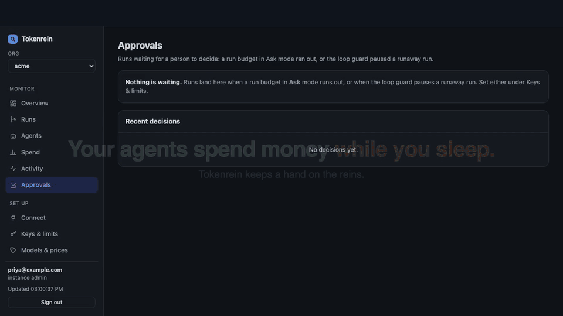
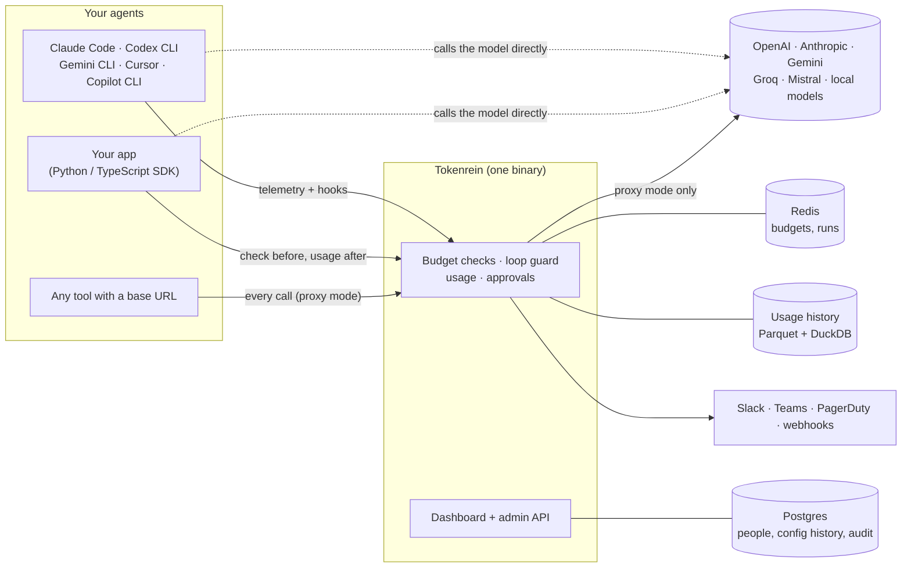
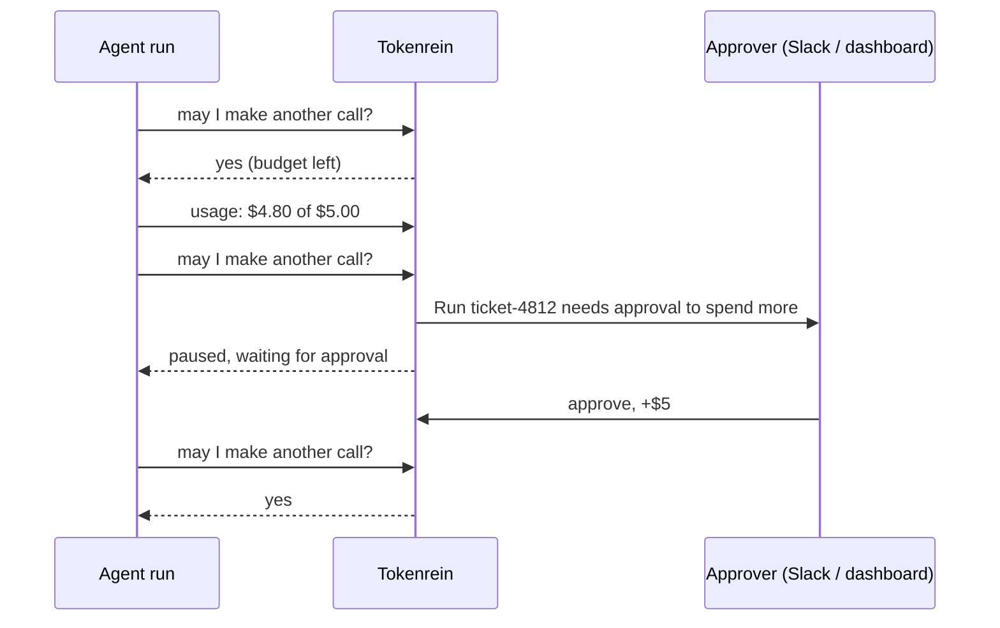

<div align="center">

# Tokenrein

### Your agents spend money while you sleep.<br>Tokenrein keeps a hand on the reins.

Give every AI agent a budget, catch runaway loops before they reach the invoice,<br>
and let a person decide when a run needs more. Self-hosted, one binary, about 1 ms per call.

[](https://github.com/tokenrein/tokenrein/actions/workflows/ci.yml)
[](https://github.com/tokenrein/tokenrein/releases)
[](https://pypi.org/project/tokenrein/)
[](https://www.npmjs.com/package/@tokenrein/sdk)
[](#license)

**[Quick start](#quick-start-docker-compose-about-5-minutes)** · **[Connect your agents](#connect-your-agents)** · **[Docs](#documentation)** · **[tokenrein.com](https://tokenrein.com)**

<a href="docs/assets/demo.mp4"></a>

<sub>51 seconds, recorded live: real Tokenrein, a mock model, no real spend. Click for the sharp MP4, or <a href="#see-it-without-an-api-key">run it yourself</a>.</sub>

</div>

## Four agents, four ways to burn money

| Your agent… | Tokenrein… | You set |
|---|---|---|
| 💸 **drifts over a limit** | warns on the response and logs it; nothing breaks | **Check** |
| ✋ **runs out of its run budget** | pauses the run and asks a person; approve and it picks up where it stopped | **Ask** |
| 🔁 **repeats itself** | spots the same request or tool call, too much spend a minute, or too many calls, then warns, pauses or kills the run | **Loop guard** |
| 🛑 **hits a hard limit** | refuses the call before it reaches the model | **Enforce** |

Works with **Claude Code, Codex CLI, Gemini CLI, Cursor, GitHub Copilot CLI** and your own agents on any LLM.

- **Budgets per run, agent, project and org**, each one warning, blocking or asking.
- **Approvals and alerts** in the dashboard, Slack, Microsoft Teams, PagerDuty and signed webhooks.
- **One command per coding agent**, one line for your app, or a base URL. Prompts never have to pass through Tokenrein.
- **Spend you can charge back**: by project, agent, person and model, over up to 13 months, with CSV export.
- **Built for teams**: SSO (OpenID Connect), roles per org, API tokens, every change versioned and audited, Docker Compose and Helm.
- **Free to self-host** up to 25 developers and $10,000 of AI spend a month, with every guardrail.

## See it without an API key

The agents in the video are in [`demo/`](demo/). Run them against a fake model, then approve or stop
their runs in your own dashboard. Needs Rust, Redis, Postgres, Node and Python.

```bash
git clone https://github.com/tokenrein/tokenrein && cd tokenrein
cargo build --release -p tokenrein && demo/run.sh
```

## How it works



Two ways to connect, both feeding the same budgets and dashboard:

- **Direct (default)**: agents keep calling their model provider. Tokenrein gets a check before
  each call and the token usage after it, from the SDK, or from the agent's own telemetry and
  hooks. Prompts and responses never leave your agents.
- **Proxy**: point any OpenAI- or Anthropic-compatible client at Tokenrein. Every call is checked
  and its worst-case cost reserved before it is sent, which stays exact under heavy concurrency.

What happens when a run hits its limit:



## Quick start (Docker Compose, about 5 minutes)

```bash
git clone https://github.com/tokenrein/tokenrein && cd tokenrein/deploy
./setup.sh              # writes .env with fresh secrets; pass your HTTPS address for production
docker compose up -d
docker compose exec tokenrein tokenrein create-owner you@company.com
```

Open the printed link to set your password, then create your org under **Keys & limits**. The
**Get started** checklist on the Overview walks you through the rest: create a project key,
connect an agent, pick a guardrail pack, and switch the limits you trust from Check to Enforce.
A step-by-step walk-through: [docs/quickstart.md](docs/quickstart.md).
Kubernetes: `helm install tokenrein deploy/helm/tokenrein`. See [docs/install.md](docs/install.md).

## Connect your agents

| Agent | How |
|---|---|
| Claude Code | `curl -fsSL http://127.0.0.1:8788/connect/claude-code.py \| python3 - --key tr_… --url http://127.0.0.1:8787` |
| Codex CLI · Gemini CLI · Cursor · GitHub Copilot CLI | the same command with `codex.py`, `gemini.py`, `cursor.py` or `copilot.py` (`sudo … --policy` sets Copilot up for every user of a machine) |
| Python | `client = guard.openai(OpenAI(), agent="support-bot")` ([sdk/python](sdk/python)) |
| TypeScript | `const client = guard.anthropic(new Anthropic(), { agent: 'support-bot' })` ([sdk/typescript](sdk/typescript)) |
| Anything else | base URL `http://127.0.0.1:8787` (OpenAI-style: `…/v1`), API key `tr_…` |

The dashboard's **Connect** page creates the key and shows the exact command for each one.

```python
from openai import OpenAI
from tokenrein import guard

client = guard.openai(OpenAI(), agent="support-bot")      # still calls OpenAI directly
with guard.run("ticket-4812", budget_usd=5):              # one task = one run
    client.chat.completions.create(model="gpt-4o-mini", messages=[...])
```

## Performance

Measured with [k6](loadtest/) on one Apple M5 Pro laptop, with one Tokenrein instance, a local
Redis and a fake OpenAI upstream that answers at once, so the numbers are Tokenrein's own time.
Every budget was enforced and the loop guard was on. Across 1.8 million requests (about 600,000
each of proxied model calls, checks and usage reports) there were no errors, no dropped usage
events and no ledger errors.

| Calls per second | Time added to a model call (p50 / p99) | `POST /v1/check` p99 | `POST /v1/usage` p99 |
|---|---|---|---|
| 500 | 1.0 ms / 1.0 ms | 1.2 ms | 1.2 ms |
| 2,000 | 0.3 ms / 0.3 ms | 0.4 ms | 0.4 ms |
| 5,000 | 0.6 ms / 1.2 ms | 0.3 ms | 0.6 ms |
| 10,000 | 1.0 ms / 2.2 ms | 0.5 ms | 0.9 ms |

A model call takes from half a second to minutes, so this is well under 1% of it. One instance
reached about 10,000 proxied calls per second with k6, Redis and the upstream sharing its CPU;
for more, add instances behind a load balancer (the Helm chart scales them). With Redis on
another host, add its network round trip. Run it yourself with `loadtest/run.sh`.

## Documentation

| Guide | For |
|---|---|
| [Developer guide](docs/developers.md) | SDKs, runs and sub-agents, budgets and modes, errors, headers, proxy-free endpoints, local development |
| [Enterprise guide](docs/enterprise.md) | Deployment, SSO and roles, approvals and alerts, loop guard, audit and SIEM, data handling and security, rollout |
| [Install](docs/install.md) · [Operations](docs/operations.md) | Docker Compose, Helm, backups, upgrades; runbooks, metrics, alerts |
| [Free tier and license keys](docs/licensing.md) | What is free, what a Team or Enterprise key adds, adding a key, expiry |
| [Connectors](docs/connectors.md) | What each coding-agent connector reads and changes |
| [Admin API](docs/api.md) | Every endpoint and the role it needs |
| [SDKs](sdk/README.md) | Python and TypeScript reference |
| [Changelog](CHANGELOG.md) | Releases |

## Repository

| Path | What it is |
|---|---|
| `proxy/` | Tokenrein itself (Rust): proxy, usage ingest, budget ledger (Redis), people and audit (Postgres), usage history (Parquet + DuckDB), alerts, dashboard (`proxy/src/web`) |
| `sdk/python`, `sdk/typescript` | SDKs (Apache-2.0) |
| `deploy/` | Docker Compose stack and Helm chart; `Dockerfile` builds the image |
| `config/dev.toml` | Local development config |
| `loadtest/` | k6 load test: the time Tokenrein adds to each call, and the SDK endpoints |
| `demo/` | The agents in the README video, a fake model and the script that records it |
| `site/` | Product website (tokenrein.com); `cd site && wrangler deploy` publishes it |
| `.github/workflows/` | CI (fmt, clippy, tests against real Redis and Postgres, SDK suites on several provider SDK versions, dependency audits, SBOM) and release (multi-arch image to GHCR, SDKs to PyPI and npm) |

## Develop

```bash
redis-server --daemonize yes
cargo test                      # Rust: unit and integration tests (also starts Postgres if installed)
cd sdk/python && python3 -m venv .venv && .venv/bin/pip install -e ".[test]" && .venv/bin/pytest
cd sdk/typescript && npm install && npm test
```

Running from source is in the [developer guide](docs/developers.md#run-from-source).

## License

The server (`proxy/`, its container image and the Helm chart) is under the
[Elastic License 2.0](LICENSE): you can use it, change it and run it in your own infrastructure,
but you may not offer it to others as a hosted or managed service. The SDKs (`sdk/`) and the
coding-agent connector scripts (`proxy/src/connect_*.py`) are Apache-2.0.

Self-hosting is free up to 25 developers and $10,000 of AI spend a month, with every guardrail.
Single sign-on, audit export, long usage history, PagerDuty, the Cursor import and multiple orgs
need a license key: see [docs/licensing.md](docs/licensing.md) and
[tokenrein.com/#pricing](https://tokenrein.com/#pricing).
