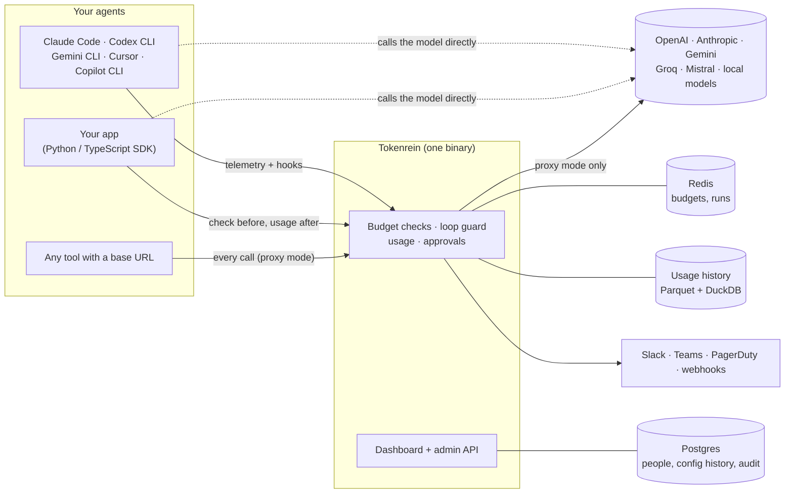
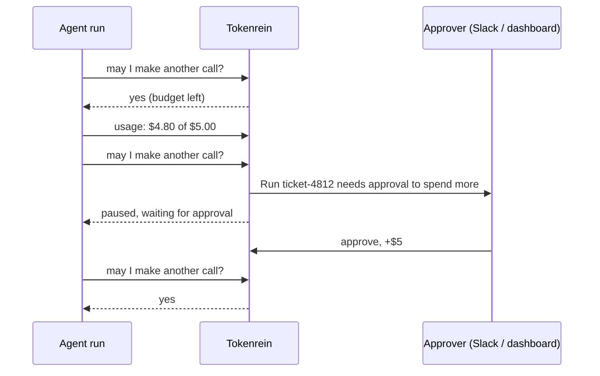

# Tokenrein

**Spend guardrails for AI agents.** Give every agent run, agent and project a budget, stop runaway
loops before they reach the invoice, and let a person approve the runs that need more. Works with
Claude Code, Codex CLI, Gemini CLI, Cursor, GitHub Copilot CLI and your own agents on any LLM.
Self-hosted, with single sign-on and an audit log.

[](https://github.com/tokenrein/tokenrein/actions/workflows/ci.yml)

- **Budgets that act before the money is spent**: per run, per agent per day, per project and org
  per month. Each one can warn (Check), block (Enforce) or pause the run and ask a person (Ask).
- **Loop guard**: the same request or tool call over and over, too much spend in a minute, or too
  many calls in one run, and the run is paused for approval (or stopped).
- **Approvals and alerts**: Slack, Microsoft Teams, PagerDuty and signed webhooks; approve or stop
  from the dashboard.
- **Connect in a minute**: one command per coding agent, one line for your app, or a base URL.
  Prompts never have to pass through Tokenrein.
- **Built for teams**: SSO (OpenID Connect), roles per org, API tokens, every change versioned and
  audited, Docker Compose and Helm.
- **Spend you can charge back**: by project, agent, person and model, over up to 13 months, with
  CSV export (usage history in Parquet files, queried with DuckDB).

## How it works



Two ways to connect, both feeding the same budgets and dashboard:

- **Direct (default)**: agents keep calling their model provider. Tokenrein gets a check before
  each call and the token usage after it, from the SDK, or from the agent's own telemetry and
  hooks. Prompts and responses never leave your agents.
- **Proxy**: point any OpenAI- or Anthropic-compatible client at Tokenrein. Every call is checked
  and its worst-case cost reserved before it is sent, which stays exact under heavy concurrency.

What happens when a run hits its limit:



## Quick start (Docker Compose, about 5 minutes)

```bash
git clone https://github.com/tokenrein/tokenrein && cd tokenrein/deploy
cp .env.example .env    # fill in the two secrets and the Postgres password (see comments)
docker compose up -d
docker compose exec tokenrein tokenrein create-owner you@company.com
```

Open the printed link to set your password, then sign in at <http://127.0.0.1:8788/>. The
**Get started** checklist walks you through the rest: save a provider key, create a project key,
connect an agent, pick a guardrail pack, and switch the limits you trust from Check to Enforce.
Kubernetes: `helm install tokenrein deploy/helm/tokenrein`. See [docs/install.md](docs/install.md).

## Connect your agents

| Agent | How |
|---|---|
| Claude Code | `curl -fsSL http://127.0.0.1:8788/connect/claude-code.py \| python3 - --key tr_… --url http://127.0.0.1:8787` |
| Codex CLI · Gemini CLI · Cursor · GitHub Copilot CLI | the same command with `codex.py`, `gemini.py`, `cursor.py` or `copilot.py` (`sudo … --policy` sets Copilot up for every user of a machine) |
| Python | `client = guard.openai(OpenAI(), agent="support-bot")` ([sdk/python](sdk/python)) |
| TypeScript | `const client = guard.anthropic(new Anthropic(), { agent: 'support-bot' })` ([sdk/typescript](sdk/typescript)) |
| Anything else | base URL `http://127.0.0.1:8787` (OpenAI-style: `…/v1`), API key `tr_…` |

The dashboard's **Connect** page creates the key and shows the exact command for each one.

```python
from openai import OpenAI
from tokenrein import guard

client = guard.openai(OpenAI(), agent="support-bot")      # still calls OpenAI directly
with guard.run("ticket-4812", budget_usd=5):              # one task = one run
    client.chat.completions.create(model="gpt-4o-mini", messages=[...])
```

## Performance

Measured with [k6](loadtest/) on one Apple M5 Pro laptop, with one Tokenrein instance, a local
Redis and a fake OpenAI upstream that answers at once, so the numbers are Tokenrein's own time.
Every budget was enforced and the loop guard was on. Across 1.8 million requests (about 600,000
each of proxied model calls, checks and usage reports) there were no errors, no dropped usage
events and no ledger errors.

| Calls per second | Time added to a model call (p50 / p99) | `POST /v1/check` p99 | `POST /v1/usage` p99 |
|---|---|---|---|
| 500 | 1.0 ms / 1.0 ms | 1.2 ms | 1.2 ms |
| 2,000 | 0.3 ms / 0.3 ms | 0.4 ms | 0.4 ms |
| 5,000 | 0.6 ms / 1.2 ms | 0.3 ms | 0.6 ms |
| 10,000 | 1.0 ms / 2.2 ms | 0.5 ms | 0.9 ms |

A model call takes from half a second to minutes, so this is well under 1% of it. One instance
reached about 10,000 proxied calls per second with k6, Redis and the upstream sharing its CPU;
for more, add instances behind a load balancer (the Helm chart scales them). With Redis on
another host, add its network round trip. Run it yourself with `loadtest/run.sh`.

## Documentation

| Guide | For |
|---|---|
| [Developer guide](docs/developers.md) | SDKs, runs and sub-agents, budgets and modes, errors, headers, proxy-free endpoints, local development |
| [Enterprise guide](docs/enterprise.md) | Deployment, SSO and roles, approvals and alerts, loop guard, audit and SIEM, data handling and security, rollout |
| [Install](docs/install.md) · [Operations](docs/operations.md) | Docker Compose, Helm, backups, upgrades; runbooks, metrics, alerts |
| [Free tier and license keys](docs/licensing.md) | What is free, what a Team or Enterprise key adds, adding a key, expiry |
| [Connectors](docs/connectors.md) | What each coding-agent connector reads and changes |
| [Admin API](docs/api.md) | Every endpoint and the role it needs |
| [SDKs](sdk/README.md) | Python and TypeScript reference |
| [Changelog](CHANGELOG.md) | Releases |

## Repository

| Path | What it is |
|---|---|
| `proxy/` | Tokenrein itself (Rust): proxy, usage ingest, budget ledger (Redis), people and audit (Postgres), usage history (Parquet + DuckDB), alerts, dashboard (`proxy/src/web`) |
| `sdk/python`, `sdk/typescript` | SDKs (Apache-2.0) |
| `deploy/` | Docker Compose stack and Helm chart; `Dockerfile` builds the image |
| `config/dev.toml` | Local development config |
| `loadtest/` | k6 load test: the time Tokenrein adds to each call, and the SDK endpoints |
| `site/` | Product website (tokenrein.com); `cd site && wrangler deploy` publishes it |
| `.github/workflows/` | CI (fmt, clippy, tests against real Redis and Postgres, SDK suites on several provider SDK versions, dependency audits, SBOM) and release (multi-arch image to GHCR, SDKs to PyPI and npm) |

## Develop

```bash
redis-server --daemonize yes
cargo test                      # Rust: unit and integration tests (also starts Postgres if installed)
cd sdk/python && python3 -m venv .venv && .venv/bin/pip install -e ".[test]" && .venv/bin/pytest
cd sdk/typescript && npm install && npm test
```

Running from source is in the [developer guide](docs/developers.md#run-from-source).

## License

The server (`proxy/`, its container image and the Helm chart) is under the
[Elastic License 2.0](LICENSE): you can use it, change it and run it in your own infrastructure,
but you may not offer it to others as a hosted or managed service. The SDKs (`sdk/`) and the
coding-agent connector scripts (`proxy/src/connect_*.py`) are Apache-2.0.

Self-hosting is free up to 25 developers and $10,000 of AI spend a month, with every guardrail.
Single sign-on, audit export, long usage history, PagerDuty, the Cursor import and multiple orgs
need a license key: see [docs/licensing.md](docs/licensing.md) and
[tokenrein.com/#pricing](https://tokenrein.com/#pricing).
