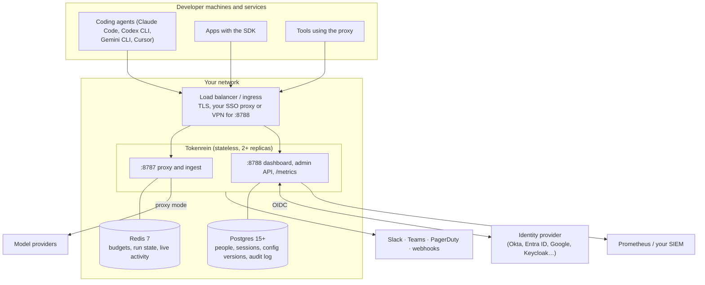

# Enterprise guide

For platform, security and FinOps teams running Tokenrein for their company: how to deploy it,
connect your identity provider, set up approvals and alerts, roll it out without blocking anyone,
and what it stores.

- [Architecture](#architecture)
- [Deploy](#deploy)
- [People, roles and single sign-on](#people-roles-and-single-sign-on)
- [Guardrails: budgets, approvals, loop guard](#guardrails-budgets-approvals-loop-guard)
- [Alerts](#alerts)
- [Audit log and SIEM](#audit-log-and-siem)
- [Data handling and security](#data-handling-and-security)
- [Rollout plan](#rollout-plan)
- [Operations](#operations)

## Architecture



- Tokenrein is one stateless binary; run two or more replicas behind a load balancer.
- **Redis** is the hot path: budget reservations and run state, updated atomically per call.
  Postgres is never called per request.
- **Postgres** is the system of record for accounts, every version of the managed config, and the
  audit log.
- Port **8787** serves agents. Port **8788** serves people: keep it on your internal network or
  behind your SSO proxy.

## Deploy

Docker Compose for a single host, Helm for Kubernetes: [install.md](install.md) covers
requirements, configuration, backups and upgrades. Minimum production settings:

| Setting | Why |
|---|---|
| `TOKENREIN_SECRETS_KEY` (64 hex) | Encrypts provider keys, the SSO client secret and alert targets. Back it up; rotate with `tokenrein rotate-secrets-key` |
| `TOKENREIN_DATABASE_URL` | Accounts, SSO, config history, audit log |
| `TOKENREIN_PUBLIC_URL` (Helm: `publicUrl`) | The dashboard's HTTPS address: SSO redirects, alert links, setup links, Secure cookies |
| `TOKENREIN_ADMIN_TOKEN` | Break-glass access. Keep it in a vault, or unset it once SSO works |
| Redis with persistence and `maxmemory-policy noeviction` | Budgets survive restarts |

Every secret can be read from a file instead (`TOKENREIN_SECRETS_KEY_FILE=/run/secrets/…`).

## People, roles and single sign-on

Create the first instance admin on the server, then sign in with the one-time link it prints:

```bash
tokenrein create-owner you@company.com          # docker compose exec tokenrein tokenrein create-owner …
```

| Role (per org) | Can |
|---|---|
| viewer | see runs, agents, spend, activity and settings |
| approver | also pause, resume and kill runs, and decide approvals |
| admin | also change projects, keys, limits, provider keys, alert channels and members (up to admin), and see the org's audit log |
| owner | also make owners and delete the org |
| instance admin | every org, model prices, accounts and single sign-on |

**Single sign-on** (People & access → Single sign-on, instance admins):

1. In your identity provider, create an OpenID Connect web application with the redirect URI shown
   there: `https://<public url>/auth/sso/callback`.
   - **Okta**: Applications → Create App Integration → OIDC, Web Application; issuer
     `https://<your-org>.okta.com` (or your authorization server's issuer). For groups, add a
     `groups` claim to the ID token.
   - **Microsoft Entra ID**: App registrations → New registration, Web redirect URI; issuer
     `https://login.microsoftonline.com/<tenant-id>/v2.0`. For groups, set "groups claim" in Token
     configuration (Entra sends group IDs: map those).
   - **Google Workspace**: Google Cloud console → Credentials → OAuth client ID (Web); issuer
     `https://accounts.google.com`. Set the allowed domain to your workspace domain.
   - **Keycloak / Auth0 / others**: any provider with OpenID discovery
     (`<issuer>/.well-known/openid-configuration`).
2. Paste the issuer, client ID and client secret, choose the allowed email domains, and decide
   whether accounts are created on first sign-in (with a default org and role).
3. Optionally map groups to roles, one per line: `ai-platform-admins = acme:admin`. Mapped orgs are
   kept in sync at every sign-in, so removing someone from the group removes their role.
4. **Test connection**, then turn on "Show Sign in with …". To require SSO, set
   `auth.password_login = false`; keep the admin token or one password account as a way back in.

Personal **API tokens** (`tru_…`, 1-365 days) act as their owner for scripts and automation, and
stop working when the owner is disabled or loses the role.

## Guardrails: budgets, approvals, loop guard

All settings are made in the dashboard (Keys & limits) or the admin API, apply to every replica
within two seconds, and are versioned and audited.

- **Budgets**: org monthly, project monthly, agent daily, per run. Each one is Skip, Check (allow
  and warn), Enforce (refuse) or, for run budgets, **Ask**.
- **Ask (approvals)**: a run that uses up its budget is paused and appears on the **Approvals**
  page and in your alert channels. An approver adds budget (the run continues where it stopped)
  or stops it. Every request and decision is audited.
- **Loop guard**: pauses (or stops, or only reports) a run that repeats the same request or tool
  call, spends too fast, or makes too many calls. It catches a stuck agent minutes in, not at the
  end of the month.
- **Guardrail packs** set sensible starting limits for coding agents, production agents or batch
  jobs, all in Check mode.

## Alerts

Alert channels are set per org (Keys & limits → Alerts, admins):

| Channel | Target |
|---|---|
| Slack | an incoming webhook URL |
| Microsoft Teams | an incoming webhook or Workflows "post to a channel" URL |
| PagerDuty | an Events API v2 integration key |
| Webhook | any HTTPS URL; each request is signed |

Events: budget 80% used, budget used up (requests refused), run waiting for approval, runaway
loop. Each channel picks its events; repeats are held back for a quiet period, and the last
delivery result is shown per channel. Alerts link back to the dashboard page that needs action.

**Verifying webhook signatures.** Each request carries `x-tokenrein-timestamp` and
`x-tokenrein-signature: sha256=<hex>`, the HMAC-SHA256 of `"<timestamp>.<body>"` with the signing
secret shown once when the channel was created:

```python
import hashlib, hmac, time

def verify(secret: str, timestamp: str, body: bytes, signature: str) -> bool:
    if abs(time.time() - int(timestamp)) > 300:          # reject replays
        return False
    mac = hmac.new(secret.encode(), timestamp.encode() + b"." + body, hashlib.sha256)
    return hmac.compare_digest("sha256=" + mac.hexdigest(), signature)
```

## Audit log and SIEM

Every change made in the dashboard or the admin API is recorded: who, from which address, when,
the action, and each field that changed with its old and new value. That covers budgets, keys,
members, roles, SSO, alert channels, pause, resume and kill, approvals, sign-ins and failed
sign-ins. Secrets never appear in it (only the last 4 characters). The log is append-only in
Postgres and can be downloaded as CSV (Audit log page, or `GET /admin/audit?format=csv`). Every
entry is also written to the server log as JSON with `target: "audit"`, so your log shipper can
send it to Splunk, Datadog, Elastic or Sentinel.

## Data handling and security

| What | Where | How |
|---|---|---|
| Prompts and responses | Direct mode and connectors: **never sent** to Tokenrein. Proxy mode: passed through to the provider, **not stored** | Loop detection keeps only SHA-256 hashes |
| Usage events (model, tokens, cost, run, agent, user email) | Redis: the latest 5,000 events per org, 7 days of run detail, 40 days of daily totals. With the usage history: Parquet files on your volume, kept 400 days (configurable), then deleted | For the dashboard, budgets, long-range spend reports and CSV exports for chargeback |
| Provider API keys, SSO client secret, alert URLs and keys | Managed config (Postgres) | AES-256-GCM, bound to the org and purpose; only the last 4 characters are ever shown |
| Tokenrein keys, API tokens, sessions, setup links | Postgres or managed config | SHA-256 hashes only; shown once at creation |
| Passwords | Postgres | argon2id; 12+ characters; 10 failures lock the account for 15 minutes; sign-in rate limits per address |

Other controls:

- Sessions: HttpOnly, SameSite=Lax cookies (Secure over HTTPS), CSRF header on every change,
  12-hour absolute and 2-hour idle timeouts.
- The dashboard runs with a strict Content Security Policy (no inline scripts); every admin
  response sets `X-Content-Type-Options`, `Referrer-Policy` and `frame-ancestors 'none'`.
- Single sign-on: authorization code flow with PKCE, ID token signature, issuer, audience, expiry
  and nonce checks, verified emails only.
- Fail-open by default (agents keep working when Tokenrein or Redis is down), or fail-closed per
  org.
- The container runs as non-root on a distroless image; CI runs `cargo audit`, `npm audit`,
  `pip-audit` and produces a CycloneDX SBOM.

## Rollout plan

1. **Week 1, observe.** Install, connect SSO, add one team's coding agents with the Connect page,
   and apply the Coding agents pack. Everything is in Check mode: nothing is blocked, and you see
   per-person and per-session spend from day one.
2. **Week 2, alert.** Add a Slack or Teams channel. Review the Overview's "what Enforce would have
   blocked" list with the team leads.
3. **Week 3, enforce.** Switch the limits you trust to Enforce, set run budgets to Ask, and turn
   the loop guard to Pause. Make team leads approvers.
4. **Then expand** to more teams and production agents (Production agents pack), with an org per
   business unit for chargeback (Spend by project, agent and user).

## Operations

Metrics (`/metrics`, Prometheus), runbooks for Redis or Postgres outages, secrets key rotation,
backups and upgrades are in [operations.md](operations.md) and [install.md](install.md).
